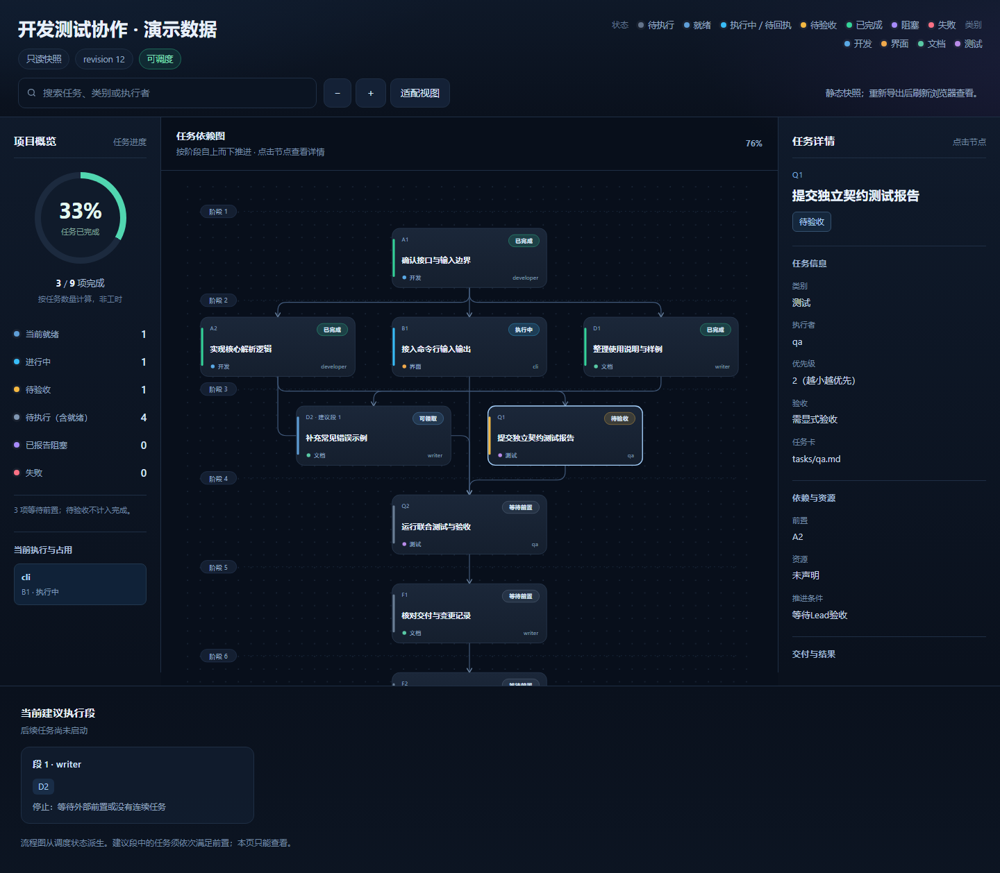

# AgentRelay · 接力

面向 **DeepSeek Harness** 的任务编排与验收插件，附带 HTML 任务图。基于宿主的团队子代理与通信能力，管理开发、测试任务的依赖、认领、交付和返工。

安装启用后默认待机。需要协作时发送“加载调度器”，由 Lead 规划任务和团队子代理分工，等全部成员回复就绪后自动开工。

[下载 v0.1.0](https://github.com/Mr-timeor/AgentRelay/releases/download/v0.1.0/dynamic-task-scheduler-0.1.0.zip) · [中文安装说明](https://github.com/Mr-timeor/AgentRelay/releases/download/v0.1.0/INSTALL.zh-CN.md) · [SHA256](https://github.com/Mr-timeor/AgentRelay/releases/download/v0.1.0/dynamic-task-scheduler-0.1.0.zip.sha256)

当前源码为 **v0.1.1 维护候选**，增加独立构建输出、跨进程单写者和可选文件证据，已完成两版 Windows 宿主的隔离验收。上方链接提供已发布的 v0.1.0。



## 工作方式


团队子代理保存各自的执行细节，Lead 处理计划、验收和异常。任务状态与交付引用保存到项目文件，成员交付后由插件检查后续就绪任务，并通过宿主向等待成员发送委托、恢复原有子会话。

## 宿主与插件的分工

| 能力 | 提供方 |
|---|---|
| 创建子代理、模型执行、消息投递、会话历史与恢复 | DeepSeek Harness |
| 任务依赖、优先级与资源约束下的认领和自动推进 | AgentRelay |
| 交付引用、验收阻断、返工反馈与运行记录 | AgentRelay |
| 从任务状态派生的 HTML 任务图 | AgentRelay |

任务理解、拆分和验收判断由 Lead 模型完成，插件校验结构化计划并执行调度规则。AgentRelay 的执行适配建立在 Harness 原生能力上；效率、费用或上下文收益需要另行实测。

## 安装

下载并解压 Release 中的 ZIP，下载者无需 npm 或重新编译。先备份目标 profile 配置并完整退出 Desktop，再使用宿主提供的 CLI 安装。

```powershell
dsh plugin --profile desktop add "<解压目录>/harness/bundle"
```

`dsh` 指 Harness 自带的 CLI，未加入 PATH 时使用其实际启动器路径。profile 名称按实际情况填写，并使用与 Desktop 相同的 DSH_HOME。安装可能建立 junction，需要保留解压后的 bundle 目录。

参考包内 `examples/desktop.patch.yml` 配置 agent-team 服务并启用 `onDemand:true`，完整重启 Harness。默认模式只需主插件，由它在准备任务后维护 HTML。

完整步骤见[下载安装](docs/下载安装.md)。包中的插件标识为 `dynamic-task-scheduler`，项目名称为 AgentRelay。

## 开始使用

在目标项目的会话中发送以下提示，并补充真实需求。

```text
加载调度器。
这次要完成的开发和测试任务是：<具体需求>。
请规划任务依赖、交付物和团队子代理分工，生成任务集与HTML，告诉我需要几个团队子代理。
各团队子代理先阅读计划并回复自己的分工和已就绪，全部回复后再自动开工。
完成后汇总实际交付、测试结果和未解决问题。
```

无需手动新建 A、B 普通对话。Lead 根据需求提出成员数量，通过调度工具创建挂在当前 Lead 下的团队子代理。插件校验计划，生成 `.scheduler/tasks.json`、`state.json` 和 `flow.html`。在 Harness 文件预览中打开 `flow.html`，可搜索、缩放和查看任务详情。

团队成员与手动创建的普通项目对话是不同会话，名称相似也不会自动绑定。在支持的 Harness 界面中，从 Lead 会话头部的子智能体目录查看实际成员，可打开子会话或选择“在侧边栏打开”。

当前适配默认使用 `fresh` / `spawn` 创建子代理，不复制主对话聊天历史。执行所需的约束应写入计划、任务卡或委托消息；后续任务复用成员自己的子会话历史。

创建成员本身不会解锁任务。每个成员实际回复就绪后，插件才开放派发；此后成员领取、交付并继续下一项，依赖解除时自动恢复等待成员的原会话。配置了 `review:true` 的任务由 Lead 检查交付与测试证据后接受。

任务结束后可让 Lead 卸载调度流程、返回待机，项目文件与历史保留。工具示例见[快速开始](docs/快速开始.md)。

## 功能

- **依赖调度**。诊断缺失前置和依赖环，按优先级、下游解锁价值与资源占用选择任务。
- **连续执行**。给出同一成员可连续推进的执行段，实际领取时逐项检查条件。
- **等待成员推进**。依赖解除后，通过宿主向原团队子会话投递委托并恢复执行，减少人工转述和重复派发。
- **交付与返工**。传递任务卡、前置产物引用及短摘要，返工时保留已接受交付与旧报告。
- **可选文件证据**。显式声明本地文件后，记录大小和 SHA-256，验收时核对；测试命令和退出码可随回执记录。
- **计划调整**。支持追加任务及修改从未派发的任务，保留执行历史。
- **只读流程图**。左侧显示任务进度与当前占用，中间居中显示依赖图，点击节点后在右侧查看依赖、交付和运行详情；支持搜索、缩放和适配视图。

算法采用依赖与资源约束下的贪心列表调度和连续链融合，细节见[调度算法](docs/调度算法.md)。核心独立于模型厂商，目前提供的聊天平台适配器是 DeepSeek Harness。

## 验证与使用范围

v0.1.1 的同一候选 ZIP 在 **Windows Desktop 0.2.1-rc.3** 通过隔离加载和冷启动，在 **0.2.2-rc.1** 通过隔离 CLI 安装和冷启动。两轮使用宿主自带的 Node 24.21.0 和本地 mock，覆盖就绪门禁、自动派发、原会话恢复、文件验收和状态复开。实际导出的三栏任务图已用 Chrome 检查。

v0.1.0 已在 **Windows Desktop 0.2.1-rc.3、Node 24.21.0** 中完成 CLI 安装及两次冷启动验证，本地151项检查通过。启动闭环使用本地 mock，覆盖待机、准备、全员就绪后派发及原会话恢复。

本轮未实测模型对“加载调度器”的自然语言选工具过程，也未直接调用 Desktop 的 `install_bundle` 工具。其他机器与宿主版本需要适配验证。[发布说明](docs/发布说明-v0.1.0.md)

当前支持单项目、单 Lead、本地 JSON 状态。文件资源范围依赖成员遵守声明，共享工作区中的实际文件操作由开发流程管理，宿主中断后的未结束运行需要人工对账。

v0.1.1 对采用新版存储的进程实施同一状态单写者保护。正常关闭释放锁；异常退出留下的锁需确认旧进程已停止后人工恢复。文件证据检查只针对显式声明的文件，不代表文件冻结或测试已独立通过。

## 开发

需要 Node.js 22+。生成 ZIP 的命令在 Windows 下运行。

```sh
git clone https://github.com/Mr-timeor/AgentRelay.git
cd AgentRelay
npm ci
npm test
npm run check:build
npm run package:download
```

`npm run build` 和 `npm run build:view` 默认输出到 `.scheduler/build/harness/`。源码、元数据模板和共享组装逻辑是构建来源；仓库的 `harness/bundle`、`harness/view-bundle` 可能仍是已安装旧副本，开发和安装应使用新构建或解压包，不直接加载这些目录。默认构建不会覆盖日常安装。

- [设计方案](docs/设计方案.md)
- [接口与数据格式](docs/接口与数据契约.md)
- [离线评测](docs/离线评测.md)

## License

[MIT](LICENSE)。宿主与第三方依赖遵守各自的许可证。
